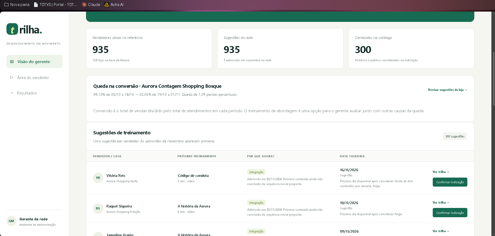
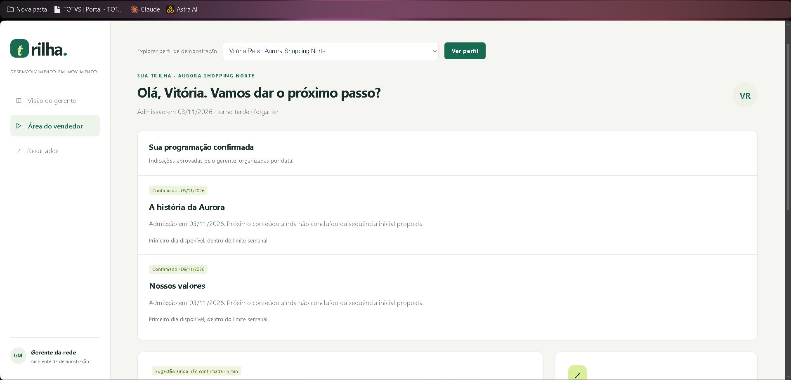
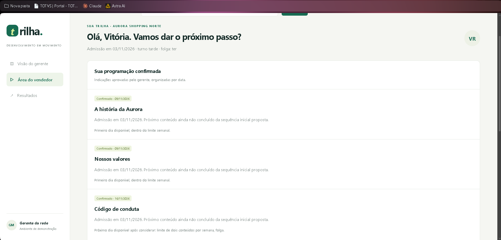

# Trilha

Protótipo de planejamento de treinamentos para equipes de varejo. Desenvolvi o Trilha como parte do desafio prático do Programa de Estágio FullStore, usando dados fictícios de uma rede de lojas.

## O problema

Uma equipe de loja precisa conciliar a integração de novos vendedores e a preparação para lançamentos com a rotina de atendimento. Para quem gerencia a equipe, isso significa decidir qual conteúdo faz sentido para cada pessoa e encontrar uma data que respeite sua escala.

## Como funciona

1. O painel mostra o próximo treinamento sugerido para cada vendedor elegível, com uma justificativa para a indicação e para a data.
2. O gerente revisa a sugestão e confirma a programação pela interface.
3. A confirmação fica salva e aparece no perfil do vendedor. Ela também passa a contar para o limite semanal de treinamentos nas próximas sugestões.

## Decisões técnicas

- **Recomendação e agendamento por regras.** A escolha do conteúdo considera o perfil do vendedor, os pré-requisitos e o histórico. A busca pela próxima data disponível leva em conta férias, folgas e o limite de dois conteúdos por semana.
- **Confirmação em SQLite.** Ao confirmar, o servidor recalcula a sugestão e registra a programação em uma transação. Assim, se duas confirmações ocorrerem quase ao mesmo tempo, a aplicação consegue respeitar o limite semanal e evitar duplicidades.
- **Explicação opcional com Gemini.** O perfil do vendedor pode exibir uma explicação em linguagem natural. A justificativa gerada pelas regras continua disponível sem configuração da API.

## Tecnologias e verificação

O protótipo usa C#, ASP.NET Core Razor Pages, SQLite e dados em CSV. As verificações automatizadas cobrem a importação dos dados, a elegibilidade dos perfis e regras de recomendação e agendamento.

O protótipo demonstra o fluxo até a confirmação no aplicativo. O histórico exibido na interface vem da base fictícia usada na demonstração.

## Demonstração

### Visão do gerente

### Perfil do vendedor

### Programação confirmada

